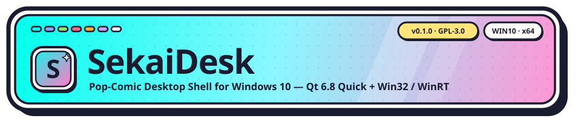
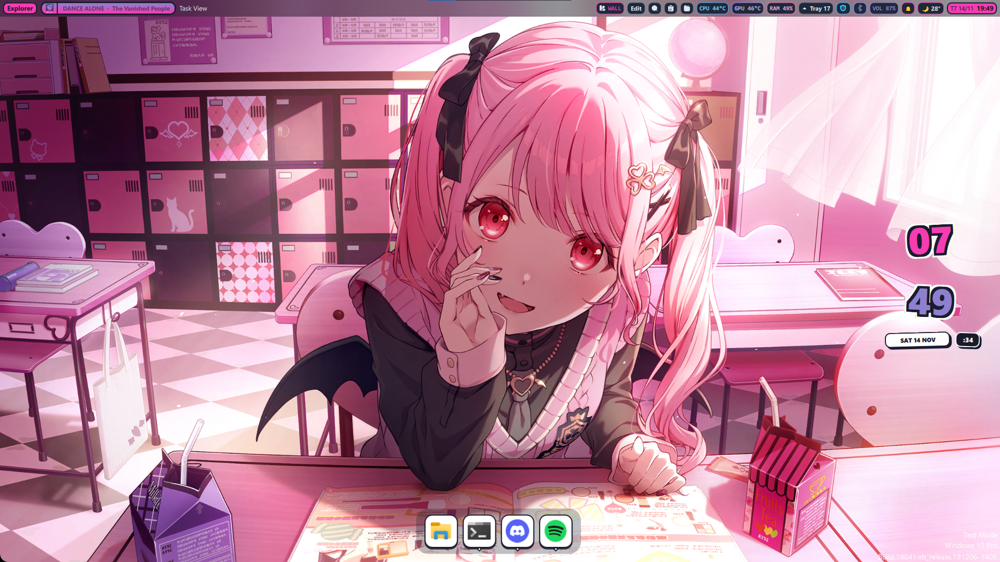
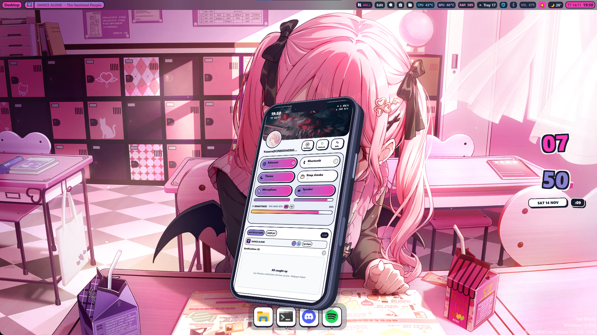
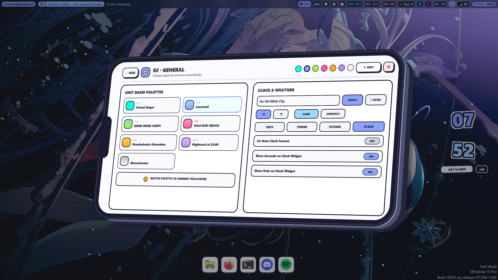
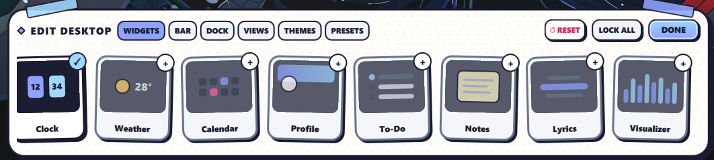

<div align="center">



<br><br>

[Showcase](#showcase) &nbsp;|&nbsp; [Features](#features) &nbsp;|&nbsp; [Requirements](#requirements) &nbsp;|&nbsp; [Installation](#installation) &nbsp;|&nbsp; [Keybinds](#keybinds) &nbsp;|&nbsp; [Credits](#credits)

<br>

<div align="left">

> ⚠️ **Note: SekaiDesk is currently built and tested on Windows 10 (64-bit).**
>
> Windows 11 compatibility is not yet verified — Windows 10 behavior and visual polish come first while Windows 11 testing is pending. Expect rough edges as features continue to be ported and refined.

</div>

<br>



<sub>Transparent Top Bar, Capsule Bottom Dock, real-time system stats (CPU / GPU / RAM), system tray integration, weather readout, and interactive desktop widgets.</sub>

</div>


<h2 id="showcase"></h2>

<table>
<tr>
<td width="50%" valign="top">

<br><b>Quick Panel: a 2.5D smartphone control center</b><br>
Slide up the portrait phone with <kbd>Ctrl</kbd> + <kbd>Alt</kbd> + <kbd>A</kbd> (or click the right status pill) for Ethernet/Wi-Fi &amp; Bluetooth toggles, Keep Awake, microphone/speaker sliders, display brightness control, active SMTC media card, and notification feed. Incoming notifications also peek from the bottom-right corner.
</td>
<td width="50%" valign="top">

<br><b>Settings: flip the phone sideways</b><br>
Rotates the Quick Panel into landscape with six structured pages: <b>01 Quick</b>, <b>02 General</b> (Unit palettes, Wallpaper Match &amp; Clock/Weather), <b>03 Bar</b>, <b>04 Desktop</b>, <b>05 Hotkeys &amp; System</b>, and <b>06 About</b>.
</td>
</tr>
<tr>
<td colspan="2" valign="top">

<br><b>Edit Desktop: scrapbook-style layout &amp; preset bar</b><br>
Toggle <b>Edit</b> from the Top Bar to customize Widgets, Bar styles (<i>Float, Straight, Transparent, Capsule</i>), Dock layout, Views, Unit Themes, and saved layout Presets on the fly.
</td>
</tr>
</table>


<h2 id="features"></h2>

Built from the ground up with **Qt 6.8 Quick** and a native **C++20 Win32 / WinRT service layer** — no heavy Electron runtime, just crisp hardware-accelerated rendering and native Windows hooks.

<table>
<tr>
<td width="50%" valign="top">
<b>Cohesive Pop-Comic Block Language</b><br>
Every pill, toggle, phone modal, and desktop widget shares the same ink outline, inner cream border, and hard offset drop shadow that reacts cleanly on press and hover.
</td>
<td width="50%" valign="top">
<b>7 Sekai Unit Themes + Live Wallpaper Match</b><br>
Switch instantly between <i>Virtual Singer</i>, <i>Leo/need</i>, <i>MORE MORE JUMP!</i>, <i>Vivid BAD SQUAD</i>, <i>Wonderlands×Showtime</i>, <i>Nightcord at 25:00</i>, and <i>Monochrome</i> — or extract a custom palette directly from your active Windows wallpaper.
</td>
</tr>
<tr>
<td valign="top">
<b>7 Interactive Desktop Widgets</b><br>
Draggable, configurable widgets: <b>Clock</b> (Keys, Tower, Sticker, Stack styles), <b>Weather</b> (Open-Meteo °C/°F), <b>Calendar</b>, <b>Profile Card</b>, <b>To-Do</b>, <b>Notes</b>, and real-time synced <b>Lyrics</b> (LRCLIB + Windows SMTC).
</td>
<td valign="top">
<b>Smart Top Bar &amp; Capsule Dock</b><br>
Four styles (<i>Float, Straight, Transparent, Capsule</i>), active window &amp; media pill with seek/controls, live CPU/GPU/RAM telemetry, Win32 system tray icons, pinned app launcher, and fullscreen auto-hide.
</td>
</tr>
<tr>
<td valign="top">
<b>Spotlight, Clipboard &amp; Drop Shelf</b><br>
Built-in dock tools and global popups: <kbd>Alt</kbd> + <kbd>Space</kbd> Spotlight launcher (Win32 apps, calculator, quick theme/shell commands), <kbd>Ctrl</kbd> + <kbd>Alt</kbd> + <kbd>V</kbd> Clipboard history, and a drag-and-drop Drop Shelf.
</td>
<td valign="top">
<b>Custom Sekai OSD &amp; Audio Visualizer</b><br>
Intercepts volume keys to replace the default Windows 10 volume box with a Pop-Comic Sekai OSD, alongside a real-time WASAPI audio spectrum visualizer (<i>Sekai, Bars, Ring, Dots, Wave</i>).
</td>
</tr>
</table>


<h2 id="requirements"></h2>

| Component | Requirement / Notes |
|---|---|
| **Operating System** | **Windows 10 (64-bit)** (Tested &amp; primary target; Windows 11 support pending community/friend testing) |
| **Graphics / Runtime** | Direct3D 11 capable GPU (Qt 6.8 Quick RHI D3D11 backend; Qt runtime DLLs bundled in portable zip) |
| **Permissions** | Runs per-user; elevated/admin apps may require matching privilege level to observe fullscreen/tray state |
| **Build Toolchain** *(source only)* | CMake 3.21+, C++20 compiler (MinGW-w64 GCC / LLVM-MinGW), Qt 6.8+ (`Quick`, `QuickControls2`, `Svg`, `ShaderEffect`) |


<h2 id="installation"></h2>

### Option 1 — Portable Build (Recommended)

1. Download **`SekaiDesk-win64.zip`** from the latest release (or find the packaged build under `package/`).
2. Extract the archive to any folder (e.g., `D:\Apps\SekaiDesk\`).
3. Run **`SekaiDesk.exe`**.

First launch starts automatically with **Peek Phone** notifications, **Capsule Bottom Dock**, and **Transparent Top Bar**, and writes your settings to `config/sekaidesk.json`.

<details>
<summary>CLI flags &amp; multi-instance testing</summary>

- `SekaiDesk.exe --instance <tag>` — Launch an isolated instance with its own mutex name for testing.
- `SekaiDesk.exe --restore` — Emergency restore if layout/config needs a clean rescue.

</details>

### Option 2 — Build from Source

```powershell
git clone <your-repo-url> SekaiDesk
cd SekaiDesk
cmake -S . -B build -G Ninja -DCMAKE_BUILD_TYPE=Release
cmake --build build -j
```

> [!TIP]
> Ensure your Qt 6.8 (`Quick`, `Svg`, `QuickControls2`, `ShaderEffect`) installation and `windeployqt` are on `PATH` when packaging a standalone folder.


<h2 id="keybinds"></h2>

| Shortcut | Action |
|---|---|
| <kbd>Alt</kbd> + <kbd>Space</kbd> | Open **Spotlight** launcher, calculator &amp; quick commands |
| <kbd>Ctrl</kbd> + <kbd>Alt</kbd> + <kbd>A</kbd> | Toggle **2.5D Quick Panel** smartphone |
| <kbd>Ctrl</kbd> + <kbd>Alt</kbd> + <kbd>V</kbd> | Open **Clipboard History** popup |
| <kbd>Volume Up</kbd> / <kbd>Down</kbd> / <kbd>Mute</kbd> | Show custom **Sekai Volume OSD** (suppresses stock Windows 10 OSD) |
| <kbd>Esc</kbd> | Close / back out of active phone, Settings, or tool popup |


<h2 id="credits"></h2>

SekaiDesk stands on the shoulders of awesome open-source projects and APIs:

- **[SekaiPop](https://github.com/Blapples/SekaiPop)** — The original Linux / Quickshell desktop shell whose Pop-Comic design system, 2.5D phone metaphors, Edit Desktop workflow, and unit themes inspired and guided this Windows port (distributed upstream under GPL-3.0).
- **[Flow Launcher](https://github.com/Flow-Launcher/Flow.Launcher)** — Reference and UX inspiration for fast Alt+Space Spotlight application search, calculation, and command filtering on Windows.
- **Libraries & Data Services**
  - [Qt 6 Quick](https://www.qt.io/) (D3D11 RHI scene graph & QML UI)
  - Windows Win32 / WinRT APIs (SMTC media control, WASAPI audio capture/peaks, DWM window thumbnails, Shell tray hooks)
  - [Open-Meteo](https://open-meteo.com/) for forecast weather data & [LRCLIB](https://lrclib.net/) for synchronized lyrics

> *Character themes and unit names are fan references to Project SEKAI COLORFUL STAGE! feat. Hatsune Miku. This is an unofficial fan project and is not affiliated with SEGA, Colorful Palette, or Crypton Future Media.*


